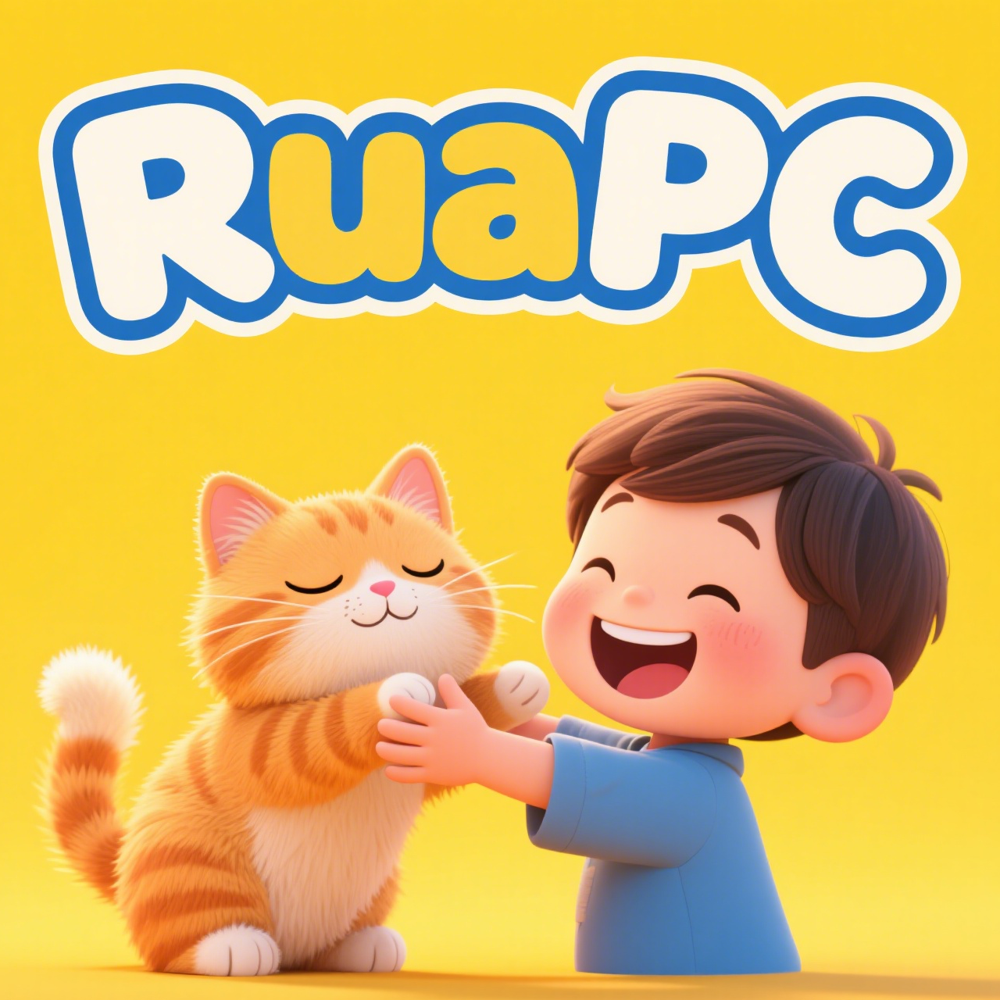

# RuaPC

[](https://github.com/SF-Zhou/ruapc/actions/workflows/rust.yml)
[](https://codecov.io/gh/SF-Zhou/ruapc)
[](https://crates.io/crates/ruapc)
[](https://github.com/mkenney/software-guides/blob/master/STABILITY-BADGES.md#work-in-progress)

Safe remote memory and typed RPC for Rust, with zero-copy RDMA and a shared
buffer API over TCP, WebSocket and HTTP/2.

RuaPC makes remote memory part of an ordinary async service call. A small typed
request describes the work; attached buffers supply its input and output.
The handler can read the caller's input, process it in place and write the
result into the caller's destination. Rust ownership and completion tracking
govern when those buffers can be accessed and reused.

The service and its buffer operations stay the same across transports. RDMA
moves bulk data directly between registered buffers, without a CPU staging copy
or serialization of those bytes. TCP, WebSocket and HTTP/2 implement the same
operations through reverse RPC and validated copies.

RuaPC is under active development. **API stability is not guaranteed before the
first stable release.**



- **One service contract.** `#[service]` generates server registration and typed
  clients that implement the same trait, with the same declared return types.
- **Explicit memory ownership.** Borrow immutable inputs and lend or transfer
  output buffers through safe Rust APIs; the runtime handles registration and
  transport completion.
- **Bidirectional connections.** Handlers can transfer data back to the caller
  over the established connection. TCP, WebSocket and HTTP can share one port.
- **Typed RPC around the data path.** MessagePack or JSON payloads, propagated
  deadlines, handler admission, OpenAPI/RapiDoc and the `metrics` facade.

See the [website](https://sf-zhou.github.io/ruapc/) and [API reference](https://docs.rs/ruapc).

## Example

This complete program defines a service that uppercases a client's buffer.
The request carries only a byte count. The handler uses `remote_read` to pull
the input, transforms the received bytes in place, then uses `remote_write`
to fill the client's output buffer before replying.

This example requires **0.2.0-alpha.8** or newer. Configure these dependencies
in your application's `Cargo.toml`:

```toml
[features]
rdma = ["ruapc/rdma"]

[dependencies]
ruapc = "0.2.0-alpha.8"
schemars = "1.2"
serde = { version = "1.0", features = ["derive"] }
tokio = { version = "1", features = ["macros", "rt-multi-thread"] }
```

Save the following program as `src/main.rs` and run `cargo run`. It exercises
the same service over TCP, WebSocket and HTTP/2 without RDMA libraries or
hardware. `cargo run --features rdma` also adds the RDMA endpoint to the loop,
which requires a usable RDMA device.

```rust
use std::sync::Arc;

use ruapc::{
    BufferReply, Client, Context, CopyOp, Endpoint, ListenMode, Result, Router, Server,
    SocketPoolConfig,
};
use schemars::JsonSchema;
use serde::{Deserialize, Serialize};

// 1. Define the shared service contract and its small control request.
#[derive(Serialize, Deserialize, JsonSchema)]
struct Request {
    len: u64,
}

#[ruapc::service]
trait TransformService {
    async fn uppercase(&self, ctx: &Context, req: &Request) -> Result<BufferReply<u64>>;
}

struct Transform;

// 2. Implement the operation, independently of the connection's transport.
impl TransformService for Transform {
    async fn uppercase(&self, ctx: &Context, req: &Request) -> Result<BufferReply<u64>> {
        let len = usize::try_from(req.len)?;
        let mut local = ctx.state.buffer_pool.allocate(len)?;
        local.set_len(len);

        // Offsets address logical byte spaces, even with multiple buffers.
        let ops = [CopyOp::new(0, 0, req.len)];
        let mut data = ctx.remote_read(&ops, vec![local]).await?;
        for buffer in &mut data {
            buffer.make_ascii_uppercase();
        }

        // Pass the same buffers to the write, then build a reply from its receipt.
        let written = ctx.remote_write(&ops, data).await?;
        Ok(written.into_reply(req.len))
    }
}

#[tokio::main]
async fn main() -> std::result::Result<(), Box<dyn std::error::Error>> {
    // 3. Register the implementation and start a server on an available port.
    let config = SocketPoolConfig {
        listen_mode: ListenMode::UNIFIED,
        ..Default::default()
    };
    let mut router = Router::default();
    TransformService::ruapc_export(Arc::new(Transform), &mut router);
    let server = Server::create(router, &config)?;
    let addr = server.listen("127.0.0.1:0".parse()?).await?;

    // 4. Create client state and allocate reusable input/output buffers.
    let base = Context::create(&config)?;
    let client = Client::default();
    let mut src = base.state.buffer_pool.allocate(4)?;
    src.set_len(4);
    src.copy_from_slice(b"Rua!");
    let mut dst = base.state.buffer_pool.allocate(4)?;
    dst.set_len(4);

    // 5. Change the endpoint; the service, client call and buffers stay the same.
    for scheme in [
        "tcp",
        "ws",
        "http",
        #[cfg(feature = "rdma")]
        "tcp+rdma",
    ] {
        let endpoint: Endpoint = format!("{scheme}://{addr}").parse()?;
        let ctx = base.with_endpoint(endpoint);
        dst.fill(0);

        let reply = client
            .with_read_buffer(&src)
            .with_write_buffer_mut(&mut dst)
            .uppercase(&ctx, &Request { len: 4 })
            .await?;

        assert_eq!(*reply.response(), 4);
        assert_eq!(&*src, b"Rua!");
        assert_eq!(&*dst, b"RUA!");
        println!("{scheme}: {}", std::str::from_utf8(&dst)?);
    }

    server.stop();
    server.join().await;
    Ok(())
}
```

`#[service]` implements `TransformService` for both `Client` and
`ClientWithBuffers`. The last call is a generated trait method; import the
service trait at the call site if it lives in another module. Plain methods
can return `Result<T>`; buffer-returning methods use `Result<BufferReply<T>>`
on both the handler and client.

`Context` supplies the connection, request deadline and shared buffer pool.
Contexts derived from `base` share runtime state and connection pools; each
`Endpoint` chooses a transport and server address group. The handler receives
a context bound to the incoming connection, which its remote-memory calls reuse.

The [crate README](ruapc/README.md) is the crates.io entry point for a smaller
echo example, installation details, client settings and feature configuration.

## Remote read/write

The example separates the control request from the bulk data. `Request` and
the returned byte count are serialized; the source and destination buffers are
attached separately. `BufferReply<T>` serializes only `T`. Its local destination
availability is filled in by the client runtime.

A buffer list forms one logical byte space by concatenating its `len()` values.
`CopyOp::new(src_offset, dst_offset, len)` selects ranges in those spaces,
independently of how either side divides memory into buffers. See the
[spaces and copy operations guide](docs/remote-memory.md#spaces-and-copy-operations)
for buffer sizing, validation rules and the operation reference.

The handler awaits each transfer, so it can process read results and observe
write errors before responding. A completed write returns a `WriteReceipt`;
`into_reply(value)` pairs that completion with an application response.

The example lends `dst` with `with_write_buffer_mut`: the awaited call restores
the buffer to that slot before returning, so the caller reads it in place.
Owned destinations can instead be attached with `with_write_buffers(vec![dst])`
and inspected through `reply.destinations()`, which returns `&BufferAvailability`;
`reply.into_parts()` returns the response and destination availability by value.
See the [remote-memory guide](docs/remote-memory.md) for whole-space helpers,
no-transfer replies and recovery options.

## Safe memory across transports

The safe API uses ownership to protect local memory during asynchronous I/O.
Read attachments borrow immutable buffers. Transfer execution takes ownership
of destinations; while a posted RDMA READ can write them, neither the caller
nor another CPU copy or READ can access those bytes. The runtime retains them
until completion evidence or successful queue-pair destruction allows recovery.
A timeout or cancelled task alone cannot release posted memory.

RDMA uses **READ in both directions**. For `remote_read`, the server reads the
client's registered source into its local buffers. For `remote_write`, a reverse
RPC asks the client to read the server's source into its own destinations and
acknowledge completion.
The receiving side therefore owns both the destination memory and the local
completion evidence. Bulk bytes travel directly between those registered
buffers; the handler in the example transforms the received buffer in place
and passes it directly to the next transfer.

These memory operations require a bidirectional connection. See
[transports and listeners](ruapc/README.md#transports-and-listeners) for the
streaming and unary HTTP interfaces, and the
[remote-memory guide](docs/remote-memory.md) for the copy-based fallback on
stream transports.

For `remote_read`, completed RDMA READs are validated through the original
borrowing request future, under the documented request-ID and cooperating-peer
assumptions. Source reuse after a failed or cancelled call does not prove that
remote DMA has stopped. Recovered error bytes are reusable memory, but are not
a valid transfer result. Lent destinations, as used above, wait for recovery
before a call returns, potentially beyond its RPC deadline; dropping or
forgetting the call can leave their slots empty. See
[safety boundaries](docs/safe-boundaries.md#application-read-source-validation-and-recovery)
for the precise ownership, validation and failure contracts.

## RDMA

Enable the [optional `rdma` feature](ruapc/README.md#optional-rdma-support) and
add `"tcp+rdma"` to the example's scheme list to run the same operation over
RDMA. `ws+rdma` and `http+rdma` select other bootstrap transports; bulk data
still uses RDMA. The example's unified listener accepts all three bootstrap
protocols, and allocating from each context's pool supplies registration for
its configured devices.

With the feature enabled, the default configuration initializes RDMA resources.
See [prerequisites](CONTRIBUTING.md#prerequisites) and
[Soft-RoCE setup](CONTRIBUTING.md#rdma-tests) for the required libraries and
devices, and the [connection guide](docs/rdma-connection.md) for bootstrap and
path configuration.

## Run the demos

The [demo quick start](ruapc-demo/README.md#quick-start) runs a service host and
typed client in separate processes. The same guide covers HTTP calls, interactive
API documentation, remote-memory workloads and load testing.

## Further reading

- [Documentation index](docs/README.md): guides, crate APIs and design contracts.
- [Architecture](DESIGN.md): workspace responsibilities and request lifecycle.
- [Contributing](CONTRIBUTING.md): environment setup and validation commands.
- [Benchmarks](docs/benchmark.md): workloads, controls and comparison method.
- [Changelog](CHANGELOG.md): released changes and migrations.

## License

Dual-licensed under [MIT](LICENSE-MIT) and [Apache-2.0](LICENSE-APACHE).
