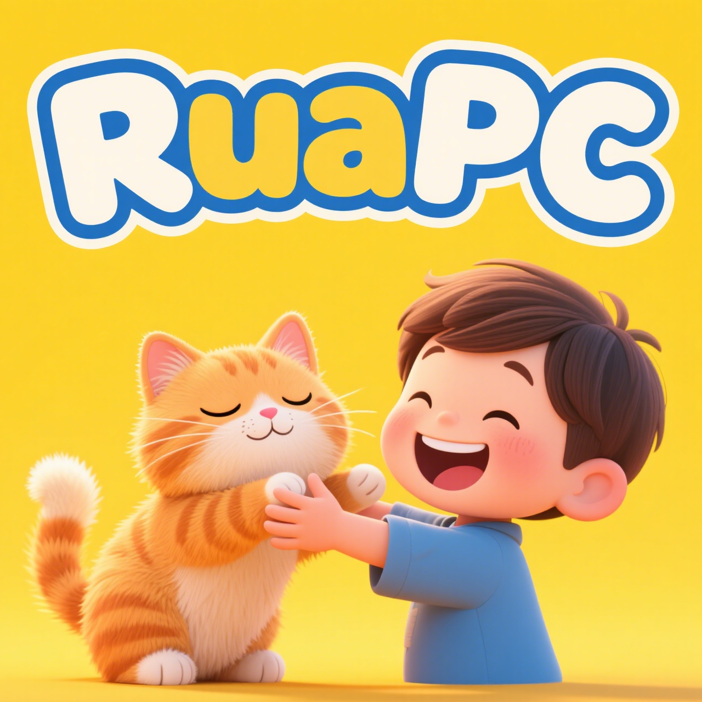

# RuaPC

[](https://github.com/SF-Zhou/ruapc/actions/workflows/rust.yml)
[](https://codecov.io/gh/SF-Zhou/ruapc)
[](https://crates.io/crates/ruapc)
[](https://github.com/mkenney/software-guides/blob/master/STABILITY-BADGES.md#work-in-progress)

A Rust RPC library with a shared service API for TCP, WebSocket, HTTP and optional RDMA.



- `#[service]` generates typed clients, server dispatch and OpenAPI schemas.
- A unified listener accepts TCP, WebSocket and HTTP on one port; RDMA bootstrap can use any of them when enabled.
- Persistent TCP, WebSocket, HTTP/2 and RDMA connections support reverse RPC.
- Remote read/write transfers use RDMA READs or inline reverse RPC over the other transports.
- Payloads use MessagePack by default; clients can select JSON. HTTP POST endpoints accept JSON.
- RapiDoc serves interactive documentation; metrics use the `metrics` facade with an application-provided recorder.

See the [website](https://sf-zhou.github.io/ruapc/), [documentation index](docs/README.md), [architecture](DESIGN.md) and [contribution guide](CONTRIBUTING.md).

## Example

Add the dependencies below. TCP, WebSocket and HTTP require no RDMA libraries.

```toml
[dependencies]
ruapc = "0.2.0-alpha.7"
schemars = "1.0"
serde = { version = "1.0", features = ["derive"] }
tokio = { version = "1", features = ["macros", "rt-multi-thread"] }
```

This program registers an echo service, makes a TCP call and shuts down the server:

```rust
use std::sync::Arc;

use ruapc::{Client, Context, Endpoint, Result, Router, Server, SocketPoolConfig};
use schemars::JsonSchema;
use serde::{Deserialize, Serialize};

#[derive(Serialize, Deserialize, JsonSchema)]
struct Request(String);

#[ruapc::service]
trait EchoService {
    async fn echo(&self, ctx: &Context, request: &Request) -> Result<String>;
}

struct Echo;

impl EchoService for Echo {
    async fn echo(&self, _ctx: &Context, request: &Request) -> Result<String> {
        Ok(request.0.clone())
    }
}

#[tokio::main]
async fn main() -> std::result::Result<(), Box<dyn std::error::Error>> {
    let config = SocketPoolConfig::default();
    let mut router = Router::default();
    EchoService::ruapc_export(Arc::new(Echo), &mut router);
    let server = Server::create(router, &config)?;
    let addr = server.listen("127.0.0.1:0".parse()?).await?;

    let ctx = Context::create(&config)?.with_endpoint(Endpoint::tcp([addr])?);
    let response = Client::default().echo(&ctx, &Request("Rua!".into())).await?;
    assert_eq!(response, "Rua!");

    server.stop();
    server.join().await;
    Ok(())
}
```

The default listener accepts TCP. Use `ListenMode::UNIFIED` to accept the other
protocols, and select the outbound transport in the endpoint, for example
`"ws://127.0.0.1:8000".parse::<Endpoint>()?`.
One endpoint can name equivalent addresses of that same server, such as
`tcp://127.0.0.1:8000,127.0.0.1:8001`. All transports support this form; see
[endpoint identity and address fallback](docs/endpoints.md).
Serde stores endpoints as that string in JSON and MessagePack. RDMA endpoints
can be constructed and exchanged without the RDMA feature; connecting requires
the feature and an enabled RDMA pool.

## Run the demos

From this repository, start the server and run a client in another terminal:

```bash
cargo run -p ruapc-demo --release --bin server -- --listen-mode unified
cargo run -p ruapc-demo --release --bin client -- tcp://127.0.0.1:8000
```

The client also accepts `ws://` and `http://`. The demo defaults to JSON;
`--use-msgpack` selects the library's default format. Open
`http://127.0.0.1:8000/rapidoc` for interactive API documentation.

The [demo guide](ruapc-demo/README.md) covers HTTP calls, base paths, remote
memory, load testing and CLI options. Ordinary HTTP POST calls are unary;
RuaPC's typed HTTP client uses an HTTP/2 stream that supports reverse RPC.

## Remote read/write

Clients attach owned read sources and write destinations. Handlers address
those buffers through logical `CopyOp` ranges, using RDMA READ or inline
reverse RPC over the other transports. `WithBuffers<T>` pairs a response with
recoverable client write buffers.

The [remote-memory guide](docs/remote-memory.md) shows a complete service and
client call, buffer sizing and recovery. The [safety contract](docs/safe-boundaries.md)
explains ownership, read-then-validate and behavior after cancellation or failure.

## RDMA

Enable the optional feature:

```toml
ruapc = { version = "0.2.0-alpha.7", features = ["rdma"] }
```

RDMA builds need a C compiler, `pkg-config`, libclang and libibverbs development
files. Running needs a usable device and sufficient locked-memory allowance.
With the feature enabled, `SocketPoolConfig::default()` initializes RDMA;
set `config.rdma = None` to disable it for a context. RDMA endpoints name their
bootstrap transport (`tcp+rdma://`, `ws+rdma://` or `http+rdma://`); servers
must serve that transport, and `UNIFIED` serves all three.

To use libibverbs' extended GID query APIs, enable
`rdma-ibv-query-gid-ex`; it also enables RDMA and forwards the backend
selection to `ruapc-rdma`:

```toml
ruapc = { version = "0.2.0-alpha.7", features = ["rdma-ibv-query-gid-ex"] }
```

See [build prerequisites](CONTRIBUTING.md#prerequisites),
[demo RDMA setup](ruapc-demo/README.md#configuration-and-rdma) and
[connection configuration](docs/rdma-connection.md).

<a id="benchmarks-and-workspace"></a>

## Further reading

- [Documentation index](docs/README.md): guides, crate APIs and design contracts.
- [Architecture](DESIGN.md): workspace responsibilities and request lifecycle.
- [Contributing](CONTRIBUTING.md): environment setup and validation commands.
- [Benchmarks](docs/benchmark.md): workloads, controls and comparison method.
- [Changelog](CHANGELOG.md): released changes and migrations.

## License

Dual-licensed under [MIT](LICENSE-MIT) and [Apache-2.0](LICENSE-APACHE).
